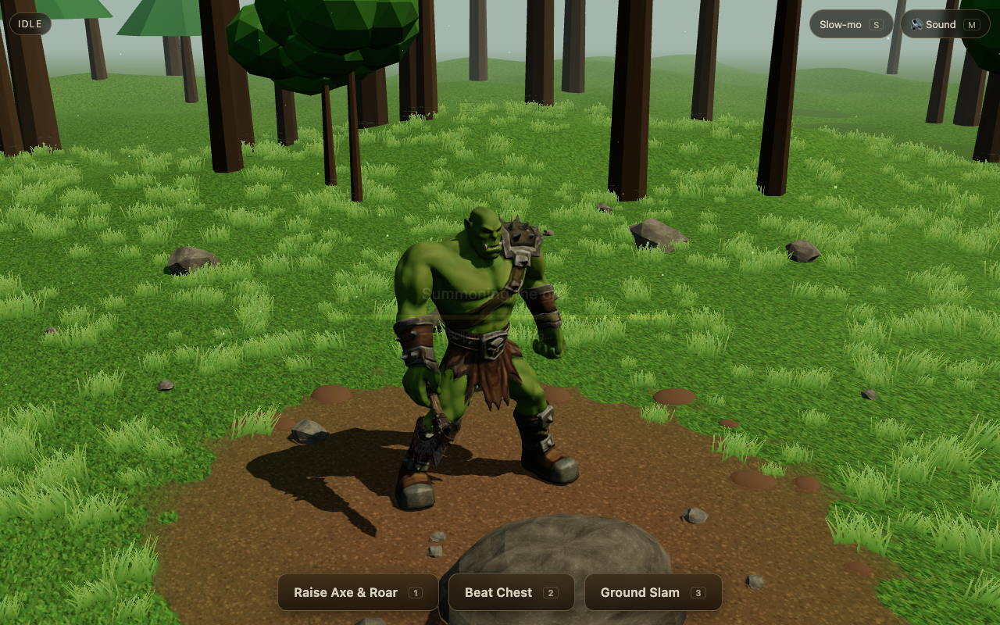
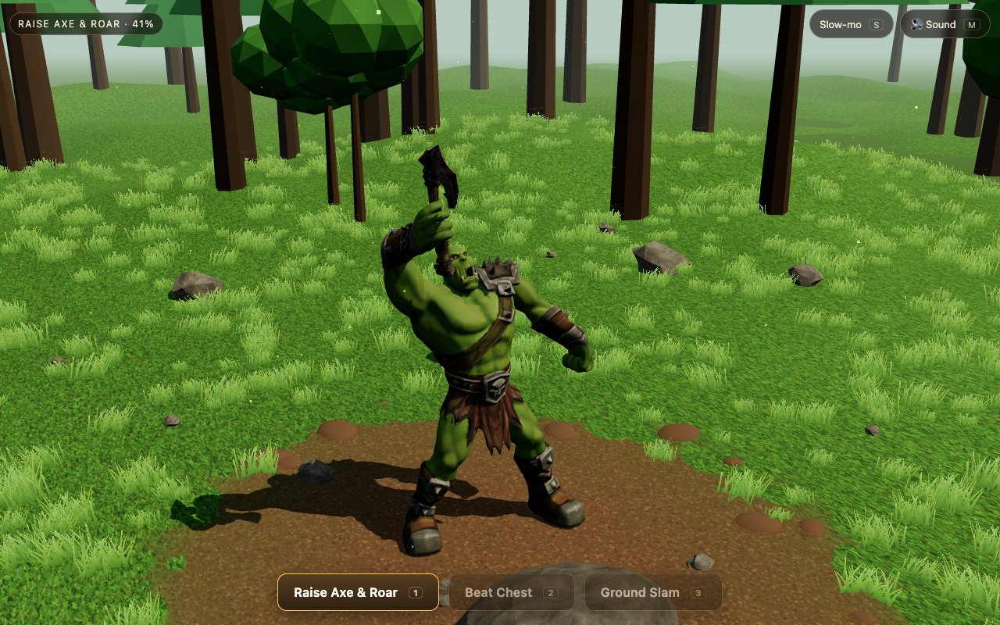
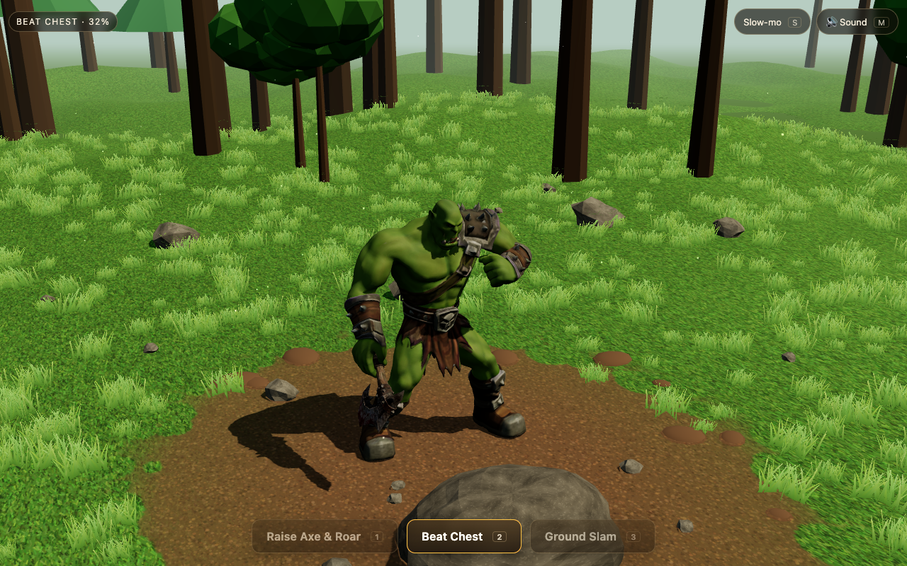
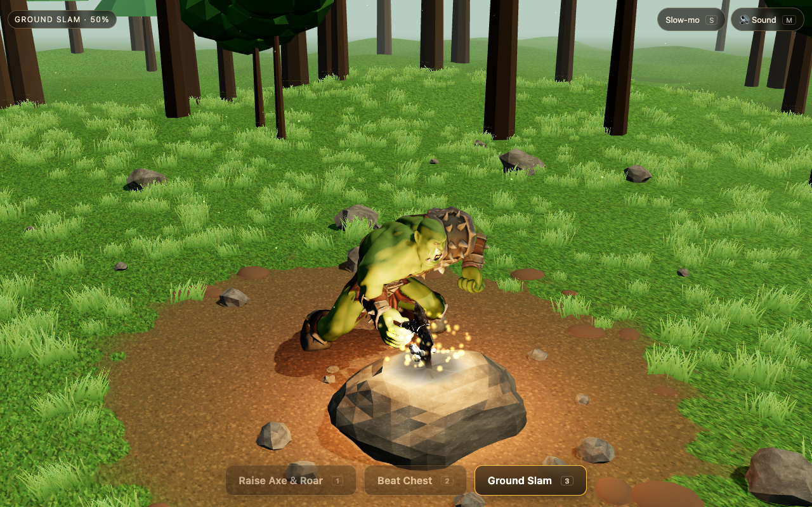

# Orc & Axe — Forest Clearing (Three.js)

An interactive Three.js scene: a massive, angry orc stands in a forest clearing holding a battle axe in his
**right** hand. The two supplied GLB files (`fantasy+orc+3d+model.glb`, `medieval+battle+axe+3d+model.glb`) are
used as-is (geometry, textures, proportions); the orc is skinned with a rig built for this project.



| Raise Axe & Roar | Beat Chest | Ground Slam |
|---|---|---|
|  |  |  |

## Run it

Requirements: Node 18+ (developed with Node 24) and a WebGL2 browser.

```bash
npm install
npm run dev          # http://127.0.0.1:5173
# or a production build
npm run build && npm run preview     # http://127.0.0.1:4173
```

Everything the page needs is in `public/assets` (models, audio) — no remote URLs at runtime.

### Controls

| Input | Action |
|---|---|
| **Raise Axe & Roar** button / `1` | knees bend, axe goes overhead, roar, three emphatic pumps |
| **Beat Chest** button / `2` | left fist strikes the upper chest three times |
| **Ground Slam** button / `3` | overhead strike, the blade hits the rock in front of the orc |
| `S` / *Slow-mo* | 0.25x time (animation, effects and sound pitch) |
| `M` / *Sound* | mute / unmute |
| mouse drag / wheel | restrained orbit and zoom |

Only one action plays at a time; presses during an action are ignored (no stacking of animations, effects or
sounds). Sound starts after the first click / key press (browser autoplay policy).

Developer lab: `/?lab` (grip calibration GUI + inspection tools, paused simulation), `/?lab&plain` (plain stage),
`/?lab&run` (lab GUI with the live simulation). `app.runInspection()` in the console runs the verification suite
described in `docs/inspection/`.

## How it is built

```
fantasy+orc+3d+model.glb  ──Blender (headless)──►  public/assets/models/orc_rigged.glb
medieval+battle+axe+….glb ──gltf-transform──────►  public/assets/models/axe_prepared.glb
tools/audio/synth_audio.py ─────────────────────►  public/assets/audio/*.mp3 + ambience_forest.wav
src/                        Three.js application (Vite)
```

### 1. Rig (`tools/rig/`)
The supplied orc is **one static, unrigged mesh in a T-pose** (no skeleton, skin, clips or morph targets), so a rig
was built (see `docs/rig_notes.md` for the measurements):

* 69 bones (53 deforming): pelvis, 3 spine, neck, head, **jaw**, clavicles, arms, **5 fingers per hand (3 joints
  each, thumb included)**, legs, feet, toes, plus a **`Socket_R` weapon socket** on the right hand.
* Skin weights: Blender heat-diffusion automatic weights on a welded copy of the mesh (the Tripo mesh is split at UV
  seams), transferred back to the original vertices; jaw weights are analytic.
* **Jaw**: the painted mouth line was turned into a real lip slit, a mouth-cavity mesh (dark gradient + tongue) was
  added, lower face / tusks are weighted to the jaw bone — the mouth really opens.
* **`Breath` morph target** (chest/belly expansion) for heavy breathing, driven together with the spine/shoulder bones.
* Scaled to 2.40 m (feet on y=0). Textures are exported unchanged.

Rebuild: `npm run prep:orc` (Blender 5.x, macOS path in `package.json`; edit if yours differs).

### 2. Axe (`tools/rig/prep_axe.mjs`)
Re-oriented into a documented frame (`+Y` handle→head, `+X` cutting edge, origin = grip centre on the handle axis,
handle straightened over the grip zone). Scale is *not* baked in.

**How the axe scale was adjusted:** the original GLBs are both normalised to ~1 unit by their generator, so their
scale is meaningless against each other. The orc was set to 2.40 m tall; the axe is applied with one uniform scale of
**0.78** (≈ 0.96 m long, ≈ 0.55 m blade, 9.1 cm handle diameter; no non-uniform scaling). The scale was chosen by
fitting against the real skinned hand: an optimiser (`app.gripMetrics`, see `docs/inspection/`) searched grip offset,
handle direction, finger curl and scale for the biggest axe whose handle fits inside the closed fist with the
fingers wrapping it (about 5 mm maximum vertex penetration in the stance, ≥ 10 of 12 circumference sectors touched).

### 3. Animation (`src/anim/`)
* `Controller.js` — state machine `idle` ↔ one action at a time. One `Pose` per frame (plain data) is built as
  `lerp(idlePose, actionPose, smoothWeight)` and handed to the single `Solver`, which is the *only* writer of bone
  transforms (FK for pelvis/spine/neck/head/jaw/shoulders/fingers, IK for legs and arms), so idle and actions can
  never overwrite each other.
* `Solver.js` + `rig/ik.js` — analytic two-bone IK with elbow/knee poles, forearm twist distribution, planted feet.
  The axe is a child of `Socket_R` (rigid: no slipping, lag or scale change); the swing comes from pelvis, spine,
  shoulder, elbow, forearm and wrist.
* `idle.js` — seamless procedural idle: slow heavy breathing (chest morph + spine, shoulders, head, arms), weight
  shifts, knee flex, sway, occasional growl with jaw movement. Feet stay planted.
* `actions/*.js` — hand-keyed raise & roar (5 s), chest beat (5 s), ground slam (4.6 s). The slam computes the contact
  from the blade's world-space geometry: the lowest point of the cutting edge for the strike orientation is dropped
  onto the real rock surface (raycast), the hand is blended from the body-relative path to that world target so the
  blade stops exactly on the stone.
* All timing is delta-time based; slow motion scales the simulation clock.

### 4. Environment, effects, audio
* `src/env/forest.js` — clearing with a dirt patch under the orc (flat so the feet plant exactly, uneven by bump map
  and clods), instanced wind-swayed grass clumps (kept out of the action area), stones, trees, hills, fog, sun with soft
  shadows. `src/env/rock.js` — the partially buried impact rock.
* `src/fx/Effects.js` — pooled sparks, dust, stone fragments, scuff mark, light flash and camera shake, all spawned
  at the blade's contact point; buffers are allocated once and recycled.
* `src/audio/AudioManager.js` + `src/events.js` — Web Audio mixer; sounds are triggered by named animation events
  (breath at the idle breathing rhythm, roar at jaw opening, thump at fist contact, whoosh on the fast part of the
  swing, impact at blade contact), with variant selection and slight pitch/gain variation.

## Verification that was actually run

See `docs/inspection/GRIP_INSPECTION.md` (both grip inspections, images and numbers) and `docs/inspection/metrics.json`.
Run with headless Chromium (software WebGL) driven by Playwright, plus Blender headless for the rig:

* Stage 1: mesh/skeleton/texture inspection of both GLBs; rig deformation tests in Blender (fist, arm raise, knees,
  spine, jaw) before export.
* **Grip inspection #1 (static, stance)** and **#2 (dynamic, all actions, idle extremes, transitions)** — images
  and numerical checks.
* Impact accuracy: planned contact = lowest blade point at the impact frame, gap to the rock surface 0 mm; no axe vertex
  ever below the rock/ground surface during the slam.
* Feet: 0 mm ankle sliding over all actions and a 60 s idle sweep.
* Robustness: 30 consecutive actions (raise, chest, slam) return to idle every time; a second request during an action
  is rejected every time; renderer geometry/texture/program counts do not grow; slow-motion 0.25x checked.
* Audio: all 29 files decode; the context is suspended until the first key press and then runs; the sounds are
  triggered at the expected animation times (logged). Levels/spectra of the generated files were analysed numerically.

### Known limitations (honest list)
* The orc's fingers are short and thick, so the grip is a firm wrap (≥ 10/12 sectors in the stance, ≥ 8/12 in the
  fastest parts of the actions) rather than a fully closed ring, and up to ~9 mm of hand-mesh/handle overlap occurs at
  the most extreme moments of the swing (handle radius 45.6 mm).
* Extreme wrist/forearm values: wrist bend up to 55° during the fast swing, forearm twist up to 156° in the overhead
  hold. The pommel stub of the handle touches the forearm/shoulder (distance ≈ 2 mm, no pass-through measured) during
  the swing of the slam.
* The audio is procedurally synthesised, not recorded; I verified loading, mixing levels and event timing but could not
  audition it by ear. The mouth interior is a simple cavity mesh.
* Only tested in headless Chromium on macOS with software rendering (no real GPU frame-rate measurement); Safari,
  Firefox and touch devices were not tested.

## Credits
See `public/assets/CREDITS.md`.
